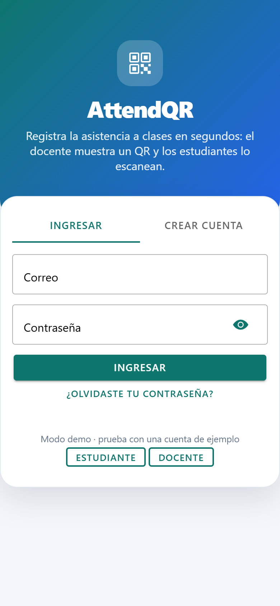
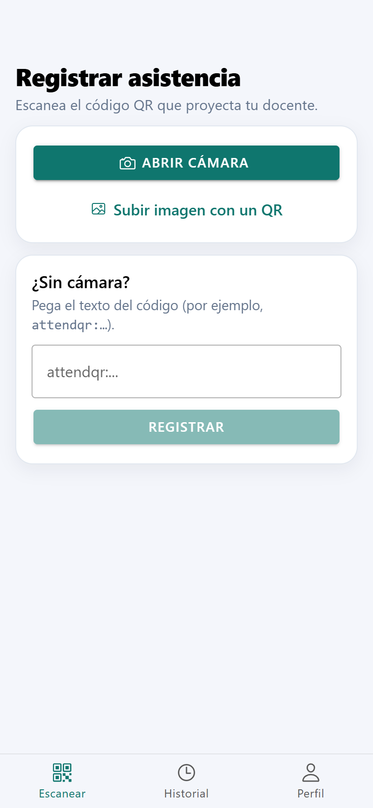

<div align="center">

# 📲 AttendQR

**Control de asistencia con códigos QR · QR-based class attendance**


[🇪🇸 Español](#-español) · [🇬🇧 English](#-english)

</div>

<p align="center">
  
  
  
  
</p>

---

## 🇪🇸 Español

AttendQR elimina las listas de papel: el **docente** crea una clase y proyecta un código QR; los **estudiantes** lo escanean con su teléfono y la asistencia queda registrada al instante, con hora y sin duplicados.

> Proyecto universitario rediseñado desde cero (antes *BrillPro*): arquitectura limpia, interfaz moderna y backend intercambiable.

### ✨ Características

- Roles **docente** y **estudiante**, con registro, inicio de sesión y recuperación de contraseña.
- El docente crea clases con asignatura, sala, horario y **ventana de registro** configurable.
- QR único por clase con código aleatorio (no se puede adivinar ni reutilizar en otra clase).
- Escaneo con **cámara**, desde una **imagen** o pegando el código.
- Lista de asistentes en vivo y **exportación a CSV** (compatible con Excel).
- Historial personal para el estudiante.
- Una sola marca por estudiante y clase; el registro se cierra al terminar la ventana.
- **Modo demo** sin configuración (datos en el navegador) o **Firebase Auth + Firestore** con reglas incluidas.

### 🧱 Arquitectura

```
src/app
├── core/            # Modelos, QR, servicios, guards y backends
│   ├── backend.ts           # Contrato abstracto
│   ├── local.backend.ts     # Modo demo (localStorage)
│   └── firebase.backend.ts  # Firebase Auth + Firestore (carga perezosa)
└── pages/           # login · tabs · classes · class-detail · scan · history · profile
```

Angular 22 con componentes *standalone*, *signals*, `OnPush`, rutas con *lazy loading*, TypeScript estricto y pruebas con Vitest.

### 🚀 Inicio rápido

```bash
git clone https://github.com/nibrill/attendqr.git
cd attendqr
npm install
npm start
```

Abre `http://localhost:4200`. Cuentas de ejemplo (contraseña `demo1234`): `docente@demo.cl` y `alumno@demo.cl`.

**Probar el flujo completo:** inicia sesión como docente → crea una clase → copia el QR; en otra pestaña inicia sesión como estudiante → «Escanear» → sube la imagen del QR o pega el código.

### 🔥 Usar Firebase (opcional)

1. Crea un proyecto en [Firebase Console](https://console.firebase.google.com) y activa **Authentication (correo/contraseña)** y **Firestore**.
2. Completa `firebase` en `src/environments/environment.ts` (ver `environment.example.ts`).
3. Publica las reglas incluidas:

```bash
npx firebase-tools deploy --only firestore:rules
```

### 📱 App móvil

```bash
npm run build
npx cap add android
npx cap sync && npx cap open android
```

> La cámara requiere HTTPS (o `localhost`) en el navegador y el permiso de cámara en el dispositivo.

### 🛠 Scripts

| Comando | Descripción |
| --- | --- |
| `npm start` | Servidor de desarrollo |
| `npm run build` | Compilación de producción |
| `npm test` | Pruebas unitarias (Vitest) |
| `npm run lint` | ESLint |

---

## 🇬🇧 English

AttendQR replaces paper attendance sheets: the **teacher** creates a class and shows a QR code; **students** scan it with their phones and attendance is recorded instantly, timestamped and duplicate-free.

> A university project rebuilt from scratch (formerly *BrillPro*).

### ✨ Features

- **Teacher** and **student** roles with sign up, sign in and password reset.
- Classes with course, room, start time and a configurable **check-in window**.
- Per-class QR with a random code; scan via **camera**, **image upload** or pasted code.
- Live attendee list and **CSV export** (Excel-friendly).
- Personal attendance history; one check-in per student and class.
- **Zero-config demo mode** or **Firebase Auth + Firestore** with included security rules.

### 🚀 Quick start

```bash
git clone https://github.com/nibrill/attendqr.git
cd attendqr
npm install
npm start
```

Demo accounts (password `demo1234`): `docente@demo.cl` (teacher) and `alumno@demo.cl` (student).

### 📄 License

[MIT](LICENSE) © Nicolás Brill
