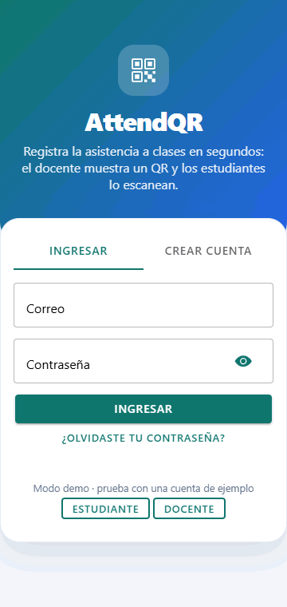
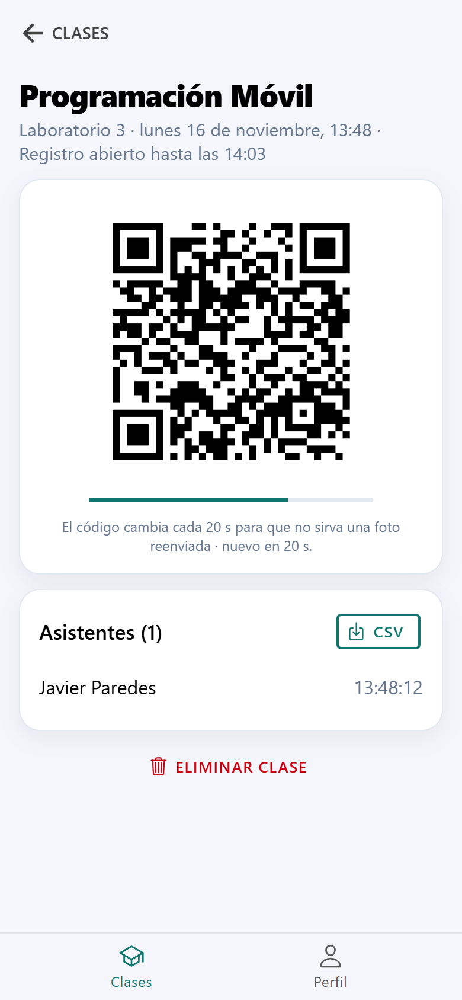
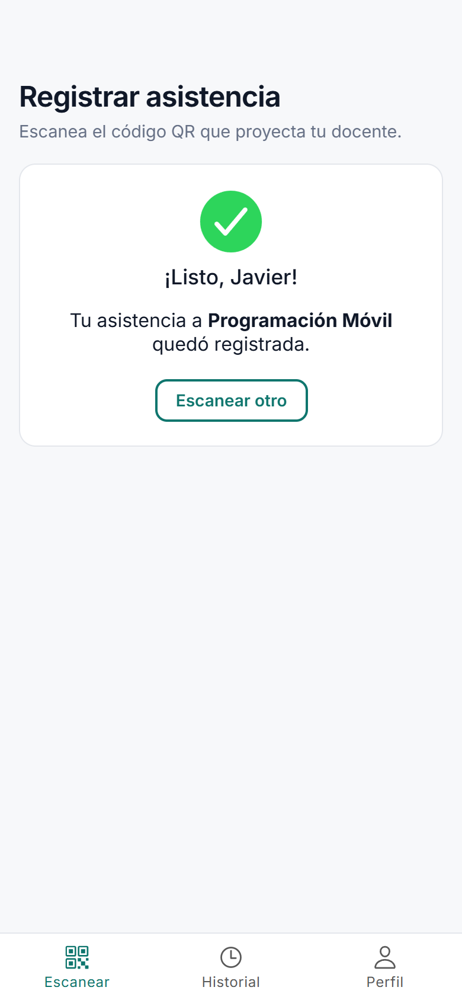

<div align="center">

# 📲 AttendQR

**Control de asistencia con códigos QR · QR-based class attendance**


[](https://github.com/nibrill/attendqr/actions/workflows/ci.yml)


### [▶ Probar la demo en vivo](https://nibrill.github.io/attendqr/) · [Usar como plantilla](https://github.com/nibrill/attendqr/generate)



[🇪🇸 Español](#-español) · [🇬🇧 English](#-english)

</div>

<p align="center">
  
  
  
  
</p>

---

## 🇪🇸 Español

AttendQR elimina las listas de papel: el **docente** crea una clase y proyecta un código QR; los **estudiantes** lo escanean con su teléfono y la asistencia queda registrada al instante, con hora y sin duplicados.

> Proyecto universitario rediseñado desde cero (antes *BrillPro*): arquitectura limpia, interfaz moderna y backend intercambiable.

### ✨ Características

- Roles **docente** y **estudiante**, con registro, inicio de sesión y recuperación de contraseña.
- El docente crea clases con asignatura, sala, horario y **ventana de registro** configurable.
- **QR rotativo**: el código cambia cada 20 segundos, así una foto reenviada a un compañero deja de servir.
- Escaneo con **cámara**, desde una **imagen** o pegando el código.
- Lista de asistentes en vivo y **exportación a CSV** (compatible con Excel).
- Historial personal para el estudiante.
- Una sola marca por estudiante y clase; el registro se cierra al terminar la ventana.
- **PWA instalable**: se puede agregar a la pantalla de inicio y abre sin conexión.
- **Modo demo** sin configuración (datos en el navegador) o **Firebase Auth + Firestore** con reglas incluidas.

### 🧱 Arquitectura

```
src/app
├── core/            # Modelos, QR, servicios, guards y backends
│   ├── backend.ts           # Contrato abstracto
│   ├── local.backend.ts     # Modo demo (localStorage)
│   └── firebase.backend.ts  # Firebase Auth + Firestore (carga perezosa)
└── pages/           # login · tabs · classes · class-detail · scan · history · profile
```

Angular 22 con componentes *standalone*, *signals*, `OnPush`, rutas con *lazy loading*, TypeScript estricto y pruebas con Vitest.

### 🚀 Inicio rápido

```bash
git clone https://github.com/nibrill/attendqr.git
cd attendqr
npm install
npm start
```

Abre `http://localhost:4200`. Cuentas de ejemplo (contraseña `demo1234`): `docente@demo.cl` y `alumno@demo.cl`.

**Probar el flujo completo:** inicia sesión como docente → crea una clase → copia el QR; en otra pestaña inicia sesión como estudiante → «Escanear» → sube una captura del QR. El código rota cada 20 segundos, así que hay que escanear el que está en pantalla.

### 🔥 Usar Firebase (opcional)

1. Crea un proyecto en [Firebase Console](https://console.firebase.google.com) y activa **Authentication (correo/contraseña)** y **Firestore**.
2. Completa `firebase` en `src/environments/environment.ts` (ver `environment.example.ts`).
3. Publica las reglas incluidas:

```bash
npx firebase-tools deploy --only firestore:rules
```

### 🔐 Cómo funciona el QR rotativo

Cada clase tiene un secreto aleatorio. El QR no lo muestra: contiene un token derivado del secreto y de la ventana de tiempo actual (SHA-256), que se regenera cada 20 segundos. Al registrar asistencia se acepta solo el token vigente o el inmediatamente anterior.

> **Limitación conocida:** la validación se hace en el cliente. Con Firebase, un estudiante con conocimientos técnicos podría leer el secreto de la clase desde Firestore. Para un uso real con control estricto, mueve `checkIn` a una Cloud Function y deja el secreto fuera del alcance de los estudiantes.

### 📱 App móvil

```bash
npm run build
npx cap add android
npx cap sync && npx cap open android
```

> La cámara requiere HTTPS (o `localhost`) en el navegador y el permiso de cámara en el dispositivo.

### 🧩 Úsalo como base para tu proyecto

Este repositorio es una **plantilla**: pulsa [**Use this template**](https://github.com/nibrill/attendqr/generate) para crear tu propia copia y luego:

1. **Renombra la app:** `name` en `package.json`, `appId` y `appName` en `capacitor.config.ts`, y el `<title>` de `src/index.html`.
2. **Cambia la identidad visual:** colores y gradiente en `src/theme/variables.scss` (variables `--ion-color-*` y `--aq-*`) e ícono en `src/assets/icon/favicon.svg`.
3. **Adapta el modelo de datos:** las entidades están en `src/app/core/models.ts`.
4. **Conecta tu backend:** toda la app habla con la clase abstracta `Backend` (`src/app/core/backend.ts`). Crea tu implementación (REST, Supabase, etc.) y regístrala en `src/main.ts`; no hay que tocar las pantallas.
5. **Quita los datos de ejemplo:** las cuentas demo y las clases y la asistencia de muestra se crean en `seed()` dentro de `src/app/core/local.backend.ts`.

Las contribuciones son bienvenidas: revisa [CONTRIBUTING.md](CONTRIBUTING.md).

### 🛠 Scripts

| Comando | Descripción |
| --- | --- |
| `npm start` | Servidor de desarrollo |
| `npm run build` | Compilación de producción |
| `npm test` | Pruebas unitarias (Vitest) |
| `npm run lint` | ESLint |

---

## 🇬🇧 English

AttendQR replaces paper attendance sheets: the **teacher** creates a class and shows a QR code; **students** scan it with their phones and attendance is recorded instantly, timestamped and duplicate-free.

> A university project rebuilt from scratch (formerly *BrillPro*).

### ✨ Features

- **Teacher** and **student** roles with sign up, sign in and password reset.
- Classes with course, room, start time and a configurable **check-in window**.
- **Rotating QR**: the code changes every 20 seconds, so a forwarded photo stops working. Scan via **camera**, **image upload** or pasted code.
- **Installable PWA** with offline support.
- Live attendee list and **CSV export** (Excel-friendly).
- Personal attendance history; one check-in per student and class.
- **Zero-config demo mode** or **Firebase Auth + Firestore** with included security rules.

### 🚀 Quick start

```bash
git clone https://github.com/nibrill/attendqr.git
cd attendqr
npm install
npm start
```

Demo accounts (password `demo1234`): `docente@demo.cl` (teacher) and `alumno@demo.cl` (student).

### 🧩 Use it as a starter

Click [**Use this template**](https://github.com/nibrill/attendqr/generate), then rename the app (`package.json`, `capacitor.config.ts`), restyle it in `src/theme/variables.scss`, and plug in your own backend by implementing the abstract `Backend` class (`src/app/core/backend.ts`) and registering it in `src/main.ts`. Try the [live demo](https://nibrill.github.io/attendqr/) first.

### 📄 License

[MIT](LICENSE) © Nicolás Brill
