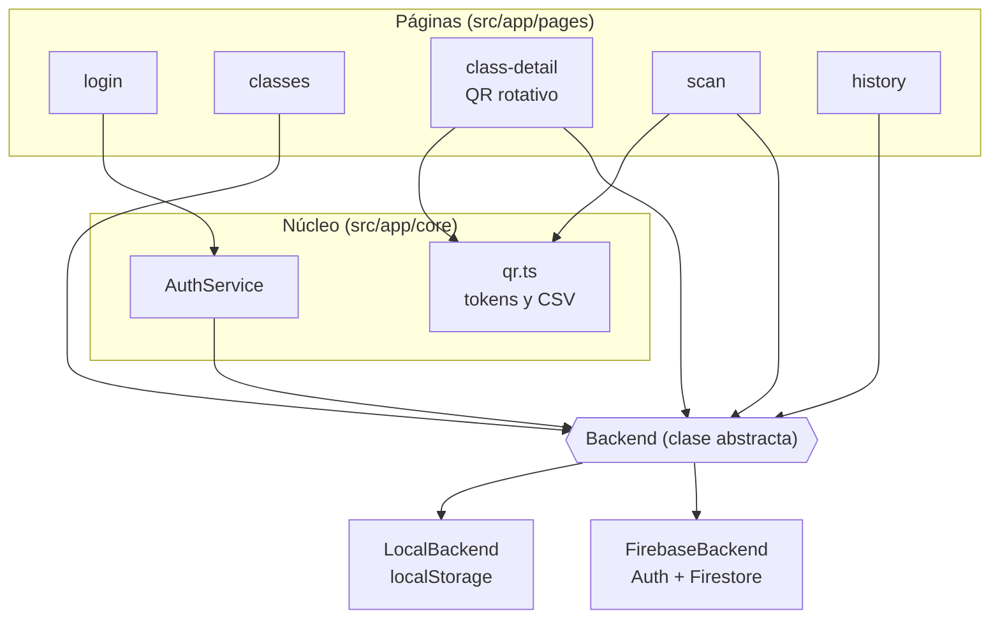

# Arquitectura de AttendQR

## Capas

Las páginas nunca hablan con Firebase ni con `localStorage`: solo con servicios y con la clase abstracta `Backend`. Por eso se puede cambiar el almacenamiento sin tocar la interfaz.

## Decisiones de diseño

### 1. Backend intercambiable
Toda la persistencia pasa por la clase abstracta `Backend`. `src/main.ts` elige `FirebaseBackend` si hay credenciales en `environment.ts` y `LocalBackend` en caso contrario.

- **Por qué:** cualquiera puede probar la app sin crear un proyecto de Firebase, y quien la use como plantilla puede conectar su propia API sin tocar las pantallas.
- **Costo:** cada operación nueva se implementa dos veces (local y Firebase).

### 2. QR rotativo derivado de un secreto
Cada clase guarda un secreto aleatorio. El QR contiene `SHA-256(secreto + ":" + ventana)`, donde la ventana cambia cada 20 s (`src/app/core/qr.ts`). Se aceptan la ventana actual y la anterior para tolerar el tiempo de escaneo.

- **Por qué:** una foto del QR reenviada a un compañero que no está en clase deja de servir en segundos.
- **Limitación:** la validación ocurre en el cliente. Con Firebase, un usuario con conocimientos técnicos podría leer el secreto desde Firestore. Para un control estricto, el registro debería hacerse en una Cloud Function (ver issues).

### 3. Una asistencia por estudiante y clase
El id del registro es `${sessionId}_${studentId}`, de modo que Firestore y el modo local impiden duplicados por construcción.

### 4. SDK de Firebase con carga perezosa
`FirebaseBackend` importa el SDK con `import()` dinámico, así que el modo demo no descarga Firebase.

## Pruebas

- **Unitarias** (`npm test`, Vitest): tokens rotativos, validación, CSV y lógica del backend local.
- **End-to-end** (`npm run test:e2e`, Playwright): flujos completos sobre el modo demo.

## Despliegue

- **CI** (`.github/workflows/ci.yml`): lint, tests, build y e2e en cada push y pull request.
- **Demo** (`.github/workflows/pages.yml`): compila y publica en GitHub Pages desde `main`. Incluye un `404.html` copiado de `index.html` para que las rutas de la SPA funcionen al recargar.
- **CodeQL** y **Dependabot** vigilan la seguridad y las dependencias.
